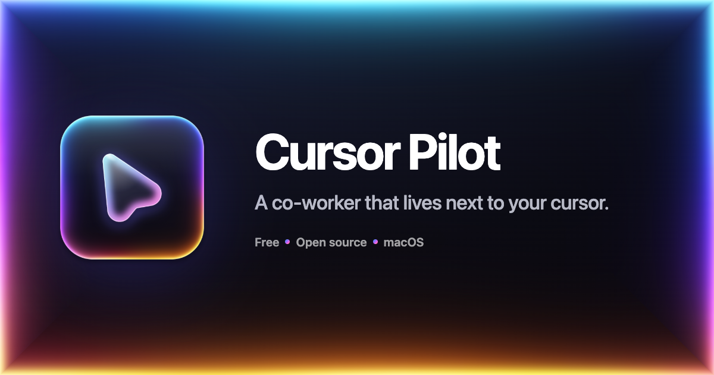
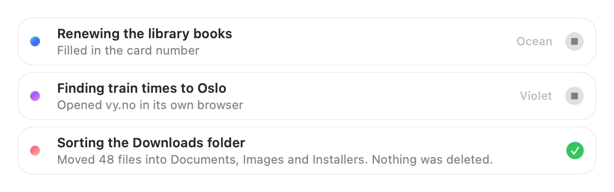
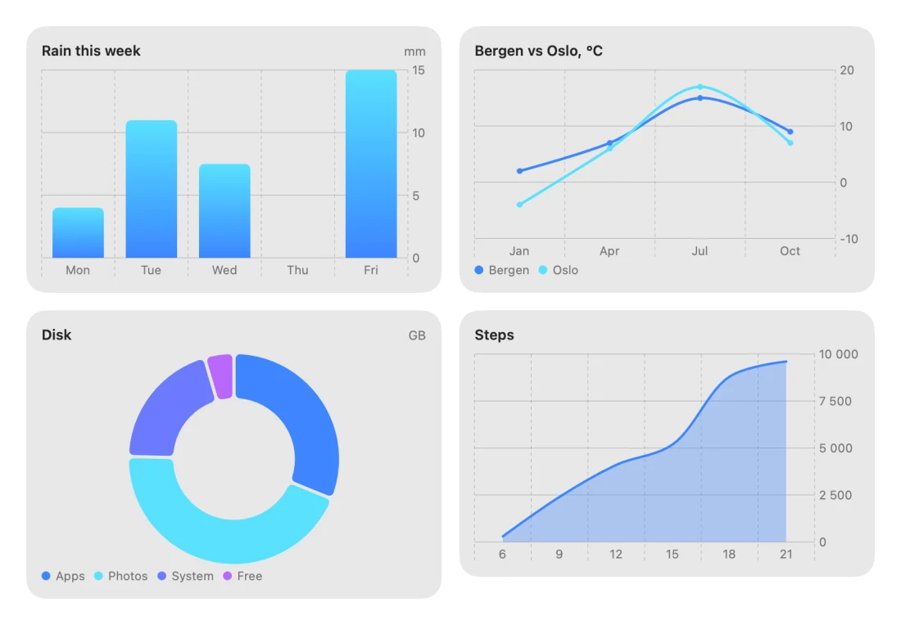

<p align="center">
  
</p>

<p align="center">
  <b>Hold <kbd>⌃</kbd> <kbd>⌥</kbd> and ask out loud.</b><br>
  Cursor Pilot looks at your screen, answers, points at what you need, or just does it for you.
</p>

<p align="center">
  <a href="https://github.com/Louistuis/cursor-pilot/releases/latest/download/Cursor-Pilot.zip"></a>
</p>

<p align="center">
  <a href="https://github.com/Louistuis/cursor-pilot/releases/latest"></a>
  
  
  <a href="LICENSE"></a>
</p>

<p align="center">
  <a href="https://cursorpilot.lou15.com">Website</a> ·
  <a href="#install">Install</a> ·
  <a href="#what-it-does">What it does</a> ·
  <a href="docs/how-it-works.md">How it works</a> ·
  <a href="https://github.com/Louistuis/cursor-pilot/releases">Releases</a>
</p>

---

## Install

1. **[Download Cursor Pilot](https://github.com/Louistuis/cursor-pilot/releases/latest/download/Cursor-Pilot.zip)** and open the zip.
2. Drag **Cursor Pilot** into your **Applications** folder.
3. Open it. The first time, macOS says it can't check the app, because it isn't
   notarised by Apple yet. Click **Done**, then open
   **System Settings › Privacy & Security**, scroll down and click **Open Anyway**.
4. Paste your [Anthropic API key](https://console.anthropic.com/settings/keys)
   and click **Set Up Everything** to grant the permissions once.

That's it. Hold <kbd>⌃</kbd> <kbd>⌥</kbd> anywhere and talk.

> Needs macOS 15 or later on an Apple Silicon Mac. It's at its best on macOS 26.
> To update, download the new version and replace the old app.

## What it does

- **Answers about what's on your screen.** Ask out loud from any app. It sees
  every display, answers in a natural voice, and its glass buddy cursor flies
  over to point, circle or draw on the thing you mean.
- **Does the job for you.** Give it access once and it runs shell commands,
  edits files (keeping a backup of each), uses your apps and searches the web.
  It says each step out loud before it takes it.
- **Keeps you in charge.** It uses your mouse and keyboard like a person and
  hands them back the moment you move the mouse, or works with a pointer of
  its own so yours stays free.
- **Works while you keep talking.** Bigger jobs go to background agents, up to
  three at once, and you can talk to it mid-task to add to or change what it's
  doing.
- **Lives in the notch.** When the work doesn't need your screen, the buddy
  waits in the notch, which lights up while it works. Live captions follow its
  voice word by word.
- **Feels like Messages.** Home keeps your chats, drawings and settings, with
  replies that can carry charts, images and link previews.

<p align="center">
  
</p>
<p align="center">
  
</p>

## Shortcuts

| Keys | What it does |
|---|---|
| Hold <kbd>⌃</kbd> <kbd>⌥</kbd> | Talk. Let go to send. Works mid-task too. |
| Double-tap <kbd>⌃</kbd> | Type a question in the notch instead. |
| <kbd>⌃</kbd> <kbd>⌥</kbd> <kbd>D</kbd> | Draw on your screen, then ask about the drawing. |

You can change the talk shortcut, or turn on hands-free conversation, in Settings.

## Privacy

- **No account and no server of ours.** Requests go straight from your Mac to
  the provider you chose, using your own API key, which is kept in your keychain.
- **No tracking.** The app has no analytics.
- **Speech your way.** On-device by default, or a cloud voice or OpenAI's live
  voice if you turn them on ([details](docs/voice-and-models.md)).
- **Nothing it touches is lost.** Every file edit keeps a backup first.

## Cost

The app is free and open source. You pay Anthropic only for what you use, with
your own key. The optional live voice and cloud voices use your own OpenAI or
OpenRouter key the same way.

## Build it yourself

Needs Xcode and Rust.

```bash
git clone https://github.com/Louistuis/cursor-pilot.git
cd cursor-pilot
scripts/build-app.sh
```

The app lands in `~/Applications`. See [Building from source](docs/building.md)
for signing, test flags and the core's tests.

## Documentation

| | |
|---|---|
| [How it works](docs/how-it-works.md) | The architecture, drawing, the whiteboard, 3D, the agent and its tools |
| [Voice, models and keys](docs/voice-and-models.md) | Speech engines, the live voice, models and which key does what |
| [Permissions](docs/permissions.md) | What each permission is for, and how to reset one |
| [Building from source](docs/building.md) | Build script, signing, debug and test flags |
| [Releasing](docs/releasing.md) | How versions are built and published |
| [Roadmap](docs/roadmap.md) | What's done and what's next |

## Contributing

Bug reports and ideas are welcome in [Issues](https://github.com/Louistuis/cursor-pilot/issues),
and pull requests too. Cursor Pilot is an independent project and isn't
affiliated with Anthropic or Apple.

## License

[MIT](LICENSE). Third-party notices are in [THIRD_PARTY_NOTICES.md](THIRD_PARTY_NOTICES.md).
